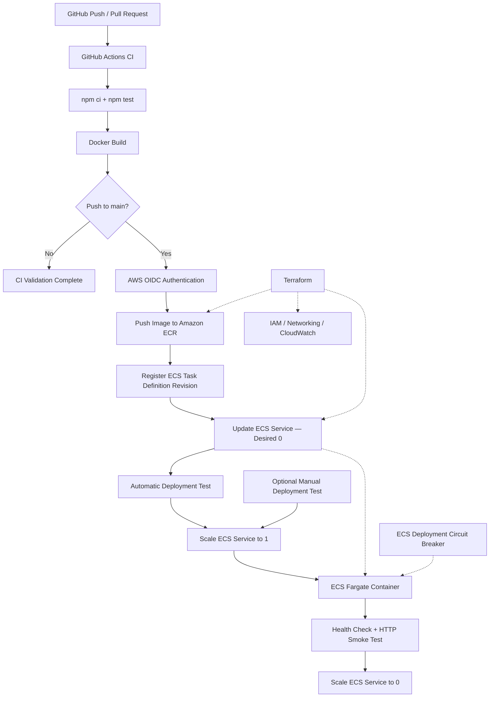

# CloudPipeline — Secure CI/CD Pipeline on AWS

A hands-on DevOps portfolio project demonstrating automated testing, Docker containerization, Infrastructure as Code, keyless AWS authentication, and container deployment recovery.

Built using **GitHub Actions, Terraform, Docker, Amazon ECR, Amazon ECS Fargate, AWS IAM, and CloudWatch**.


## Project Overview

CloudPipeline demonstrates how application code moves from a GitHub repository into AWS through a CI/CD pipeline.

The project uses a Node.js and Express application with automated tests and a `/health` endpoint.

When code is pushed to the `main` branch, GitHub Actions tests the application, builds a Docker image, authenticates to AWS using OIDC, pushes the image to Amazon ECR, and registers a new ECS task definition revision.

To control costs, the ECS service normally has a desired task count of zero. After every successful push to `main`, the pipeline temporarily starts a Fargate task, verifies the deployed image, performs a live `/health` smoke test, and scales the service back to zero. A separate manually triggered deployment-test workflow is also available.

## Architecture



### Architecture responsibilities

| Component | Responsibility |
|---|---|
| Node.js + Express | Demonstration application |
| Docker | Packages the application as a container image |
| GitHub Actions | Automates testing, image publishing, and task definition updates |
| Amazon ECR | Stores Docker images |
| Amazon ECS Fargate | Runs application containers |
| Terraform | Manages AWS infrastructure |
| AWS IAM + OIDC | Provides temporary, least-privilege AWS authentication |
| CloudWatch Logs | Stores container logs |
| ECS Circuit Breaker | Detects failed deployments and supports automatic rollback |

## CI/CD Workflows

### 1. Automatic CI/CD — `ci.yml`

Triggered by pushes and pull requests targeting `main`.

The workflow contains three jobs:

**Job 1: `test-and-build`**

1. Checks out the repository.
2. Installs Node.js dependencies.
3. Runs automated tests.
4. Builds the Docker image.

**Job 2: `check-aws-auth`**

Runs after successful tests, only for pushes to `main`.

1. Authenticates to AWS using OIDC.
2. Pushes the Docker image to ECR using the Git commit SHA.
3. Retrieves the task definition selected by the ECS service.
4. Registers a new task definition revision with the updated image.
5. Updates the ECS service, initially keeping desired count at zero.

**Job 3: `deployment-test`**

Runs automatically after the AWS publishing job succeeds.

1. Authenticates using OIDC.
2. Verifies that ECS is initially stopped.
3. Confirms the service's Docker image matches the current commit SHA.
4. Starts one ECS Fargate task.
5. Waits for ECS deployment stability.
6. Retrieves the running task's public IP address.
7. Performs an HTTP `/health` smoke test.
8. Checks that the response contains `"status": "ok"`.
9. Attempts cleanup and verifies that desired, running, and pending counts return to zero.

Pull requests run CI validation without AWS deployment.

Cleanup is best-effort; runner failures or AWS outages may still require manual intervention.

### 2. Optional Manual Deployment Test — `deploy-test.yml`

Triggered manually using `workflow_dispatch`.

This separate workflow performs a live Fargate deployment test when additional verification is needed, without requiring a new application push.

It uses OIDC authentication, ECS stability checks, the `/health` smoke test, and best-effort cleanup.

## Security Design

CloudPipeline implements several security practices:

- **Keyless authentication:** GitHub Actions uses OIDC rather than stored AWS access keys.
- **Restricted trust policy:** AWS role assumption is limited to the designated GitHub repository and `main` branch.
- **Least-privilege IAM:** Pipeline permissions are scoped to required ECR, ECS, and role-passing operations.
- **Non-root container:** The application container runs without root privileges.
- **Immutable image tags:** Docker images are identified using Git commit SHAs.
- **Private Terraform state:** Local state and sensitive variable files are excluded from Git.
- **Container health checks:** ECS verifies application health.
- **Automatic recovery:** ECS deployment circuit breaker is configured to support rollback.

**Security tradeoff:** The demonstration uses a public subnet and public IP without a permanent Application Load Balancer. This reduces infrastructure cost and complexity but is not intended as a production-grade public networking architecture.

## Infrastructure as Code

Terraform provisions the infrastructure in the separate repository:

[CloudPipeline Infrastructure](https://github.com/ahmad-abdulmajid/cloudpipeline-infra)

Resources include:

- ECR repository with an image lifecycle policy.
- ECS cluster, task definition, and service.
- CloudWatch log group.
- IAM execution and GitHub OIDC deployment roles.
- Security group and networking configuration.

Terraform owns the infrastructure structure, while GitHub Actions owns application image versions.

The ECS service uses lifecycle ignore rules for `task_definition` and `desired_count`, preventing routine Terraform operations from overwriting pipeline-managed changes.

Terraform state is currently stored locally. Remote S3 state is documented as a future improvement.

## Failure Detection and Rollback Demonstration

We tested ECS failure handling using an intentionally unhealthy task definition.

### Experiment

1. Started healthy task definition revision 12.
2. Verified that the task and container were `RUNNING` and `HEALTHY`.
3. Registered revision 13 with a health check that deliberately returned failure.
4. Observed three tasks fail container health checks.
5. Inspected the historical ECS service deployment record.

### Verified AWS evidence

On October 23, 2026, AWS reported:

```json
{
  "status": "ROLLBACK_SUCCESSFUL",
  "statusReason": "Service deployment rolled back because the circuit breaker threshold was exceeded.",
  "deploymentCircuitBreaker": {
    "status": "TRIGGERED",
    "failureCount": 3,
    "threshold": 3
  }
}
```

The deployment history identified the previously successful service revision as the rollback target.

During troubleshooting, we also manually scaled the service to zero and restored the healthy task definition selection. Therefore, the AWS record confirms the circuit breaker triggered and rollback completed, while the final service configuration was also affected by manual intervention.

See [PROJECT-LOG.md](PROJECT-LOG.md) for the troubleshooting history, observed results, and root-cause analysis.

## Challenges and Lessons Learned

| Problem | Root cause / lesson |
|---|---|
| GitHub OIDC role assumption failed | IAM trust and permissions needed correction |
| Terraform operations returned `AccessDenied` | Infrastructure provisioning required explicitly scoped AWS permissions |
| A new ECS revision inherited a broken health check | The workflow copied the latest registered task definition instead of the service-selected revision |
| Deployment remained `IN_PROGRESS` during failure testing | Task health-check failures and deployment-level circuit-breaker decisions are distinct |
| Deployment-history inspection returned `AccessDenied` | Added narrowly scoped ECS deployment-history read permissions |
| AWS reported an invalid deployment ARN | ECS deployment IDs and full service deployment ARNs are different identifiers |

These incidents were documented to demonstrate troubleshooting and security reasoning, not just successful execution.

## Cost Management

CloudPipeline is designed for a limited AWS budget.

- AWS Budget alerts monitor spending.
- The ECS service defaults to desired count 0.
- Fargate is started only for testing and demonstrations.
- The ECR lifecycle policy keeps a limited number of recent images.
- No permanent NAT Gateway or Application Load Balancer is used.
- Running and pending ECS tasks are checked after testing.

**Important:** Fargate compute, public IPv4 addresses, ECR storage, and CloudWatch usage may incur charges. AWS Budget alerts do not enforce spending limits.

## Repository Structure

The project uses separate application and infrastructure repositories.

**Application repository — `cloudpipeline-app`:**

- `Dockerfile` — Container build instructions.
- `.github/workflows/ci.yml` — Automatic CI/CD workflow.
- `.github/workflows/deploy-test.yml` — Manual live deployment test.
- `PROJECT-LOG.md` — Implementation history and troubleshooting evidence.
- `GLOSSARY.md` — Plain-language technical definitions.
- `docs/adr/` — Architecture Decision Records.

**Infrastructure repository — `cloudpipeline-infra`:**

Terraform configuration for ECS, ECR, IAM, CloudWatch, networking, and related resources.

## Documentation

Detailed engineering decisions:

- [ADR-001: Fargate vs. EC2](docs/adr/001-fargate-vs-ec2.md)
- [ADR-002: OIDC vs. AWS Access Keys](docs/adr/002-oidc-vs-access-keys.md)
- [ADR-003: Local vs. Remote Terraform State](docs/adr/003-local-vs-remote-terraform-state.md)
- [ADR-004: Terraform vs. CloudFormation](docs/adr/004-terraform-vs-cloudformation.md)
- [ADR-005: Infrastructure vs. Pipeline Ownership](docs/adr/005-terraform-vs-pipeline-ownership.md)

Additional references:

- [Project Log](PROJECT-LOG.md)
- [Technical Glossary](GLOSSARY.md)

## Future Improvements

- Introduce remote Terraform state using an encrypted S3 backend with locking.
- Use private application networking and an Application Load Balancer.
- Add stronger deployment validation based on a version-controlled task definition template.
- Automate deployment testing in an environment with an appropriate cost budget.
- Add more advanced security checks and container-image scanning policies.

## What This Project Demonstrates

CloudPipeline demonstrates practical experience with CI/CD pipelines, AWS infrastructure automation, Docker containers, federated authentication, IAM least privilege, ECS deployments, health monitoring, troubleshooting, automatic rollback, and cloud cost management.
