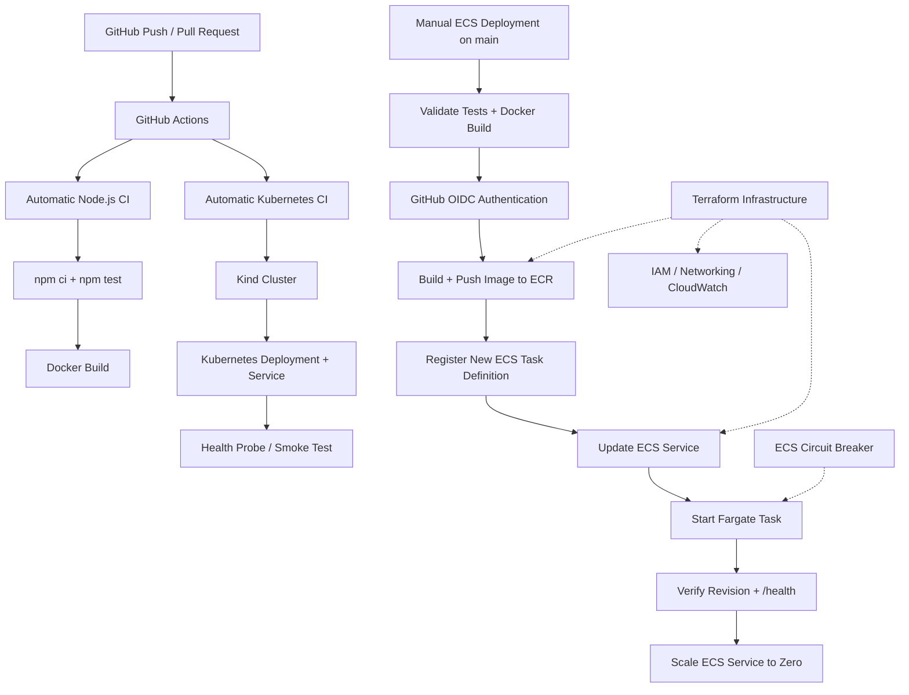

# CloudPipeline — Secure CI/CD Pipeline on AWS

A hands-on DevOps portfolio project demonstrating automated testing, Docker containerization, Infrastructure as Code, keyless AWS authentication, and container deployment recovery.

Built using **GitHub Actions, Terraform, Docker, Amazon ECR, Amazon ECS Fargate, AWS IAM, and CloudWatch**.


## Project Overview

CloudPipeline demonstrates how application code moves from a GitHub repository into AWS through a CI/CD pipeline.

The project uses a Node.js and Express application with automated tests and a `/health` endpoint.

When code is pushed to `main`, GitHub Actions automatically runs application tests and validates the Docker build. A separate Kubernetes CI workflow creates a temporary Kind cluster, deploys the application, and smoke-tests its `/health` endpoint.

AWS deployment is intentionally manual through `deploy-test.yml`. When triggered on `main`, the workflow authenticates using GitHub OIDC, pushes a commit-tagged image to Amazon ECR, registers a new ECS task definition revision, starts one Fargate task, verifies the deployed revision and `/health` response, and attempts to scale the service back to zero.

The AWS OIDC authentication test has passed independently. The updated manual ECS deployment workflow is awaiting live verification because AWS reported an account-level restriction.

To control AWS costs, the ECS service normally remains at a desired task count of zero. Fargate tasks are started only during manually triggered deployment tests and are scaled back to zero afterward. Cleanup is best-effort, with a documented manual recovery procedure available if automatic cleanup fails.

## Architecture



### Architecture responsibilities

| Component | Responsibility |
|---|---|
| Node.js + Express | Demonstration application |
| Docker | Packages the application as a container image |
| GitHub Actions | Automates testing, image publishing, and task definition updates |
| Amazon ECR | Stores Docker images |
| Amazon ECS Fargate | Runs application containers |
| Terraform | Manages AWS infrastructure |
| AWS IAM + OIDC | Provides temporary, least-privilege AWS authentication |
| CloudWatch Logs | Stores container logs |
| ECS Circuit Breaker | Detects failed deployments and supports automatic rollback |

## CI/CD Workflows

CloudPipeline uses separate workflows for application validation, Kubernetes testing, AWS authentication verification, and ECS deployment.

### 1. Automatic Application CI — `ci.yml`

Triggered by relevant pushes to `main` and pull requests targeting `main`.

The workflow:

1. Checks out the application repository.
2. Sets up Node.js 24.
3. Installs dependencies using `npm ci`.
4. Runs automated tests using `npm test`.
5. Builds the Docker image.

This workflow does not deploy to AWS.

### 2. Kubernetes CI — `kubernetes-ci.yml`

Triggered by relevant application, Kubernetes configuration, and workflow changes.

The workflow:

1. Creates a temporary Kubernetes cluster using Kind.
2. Builds and loads the application Docker image.
3. Deploys the application using Kubernetes manifests.
4. Waits for the application to become ready.
5. Tests the `/health` endpoint.

This validates Kubernetes deployment behavior without requiring Amazon EKS or other AWS resources.

### 3. Manual ECS Deployment — `deploy-test.yml`

Triggered manually using `workflow_dispatch` on the `main` branch.

The workflow:

1. Runs application tests and validates the Docker build.
2. Authenticates to AWS using GitHub OIDC.
3. Confirms the ECS service starts with zero tasks.
4. Builds and pushes a commit-tagged Docker image to Amazon ECR.
5. Registers a new ECS task definition revision.
6. Updates the ECS service and starts one Fargate task.
7. Waits for ECS stability.
8. Verifies that the service and running task use the expected task definition.
9. Performs an HTTP smoke test against `/health`.
10. Attempts to scale the service back to zero and verifies task counts.

Cleanup is best-effort. An interrupted runner or AWS service failure may require manual intervention, documented in [ECS Manual Recovery](docs/ECS-RECOVERY.md).

**Verification status:** The updated manual ECS deployment workflow has not yet completed a live test because AWS reported an account-level restriction.

### 4. Manual AWS Authentication Test — `oidc-test.yml`

Triggered manually on `main`.

This workflow authenticates to AWS using GitHub OIDC and runs `aws sts get-caller-identity` without starting ECS tasks or modifying infrastructure.

**Verification status:** Successfully passed, confirming that GitHub can assume the deployment role without stored AWS access keys.

### Workflow separation

Automatic CI and Kubernetes CI validate code changes. AWS deployment requires an explicit manual trigger, helping control costs and reducing the risk of unintended infrastructure activity.

## Kubernetes Extension

CloudPipeline includes a local Kubernetes deployment as a second way to run the application, without replacing the existing AWS ECS architecture.

### Local Kubernetes with Minikube

Minikube provides a local Kubernetes cluster for development and experimentation.

The application uses Kubernetes manifests stored in the `k8s/` directory:

| File | Purpose |
|---|---|
| `namespace.yaml` | Creates a dedicated `cloudpipeline` namespace |
| `deployment.yaml` | Defines the application Pods, container image, and health probes |
| `service.yaml` | Provides stable networking access to the application |

The deployment uses the application's `/health` endpoint for readiness and liveness checks.

### Automated Kubernetes CI with Kind

The `kubernetes-ci.yml` workflow creates a temporary Kubernetes cluster using Kind inside a GitHub Actions runner.

It builds the Docker image, loads it into the cluster, deploys the application, waits for readiness, and performs an HTTP smoke test.

This workflow has successfully passed on the `main` branch.

### Troubleshooting Exercises

The Kubernetes extension included hands-on troubleshooting of:

- `ImagePullBackOff`: Kubernetes could not retrieve the required container image.
- `CrashLoopBackOff`: The application container repeatedly failed after starting.
- Readiness probe failure: The application was running but Kubernetes could not confirm it was ready to receive traffic.

These exercises helped demonstrate how to investigate deployment failures using Kubernetes status information, events, and container logs.

### ECS vs. Kubernetes

| Amazon ECS Fargate | Kubernetes |
|---|---|
| AWS-managed container orchestration | Portable container orchestration platform |
| Uses ECS task definitions and services | Uses Deployments, Pods, and Services |
| Uses ECS container health checks | Uses readiness and liveness probes |
| Deployed to AWS | Tested locally and in GitHub Actions |
| Fargate tasks can incur AWS charges | Local Minikube and CI Kind require no AWS resources |

The Kubernetes extension is an additional deployment option. It does not replace the AWS ECS pipeline.

## Security Design

CloudPipeline implements several security practices:

- **Keyless authentication:** GitHub Actions uses OIDC rather than stored AWS access keys.
- **Restricted trust policy:** AWS role assumption is limited to the designated GitHub repository and `main` branch.
- **Least-privilege IAM:** Pipeline permissions are scoped to required ECR, ECS, and role-passing operations.
- **Non-root container:** The application container runs without root privileges.
- **Immutable image tags:** Docker images are identified using Git commit SHAs.
- **Private Terraform state:** Local state and sensitive variable files are excluded from Git.
- **Container health checks:** ECS verifies application health.
- **Automatic recovery:** ECS deployment circuit breaker is configured to support rollback.

**Security tradeoff:** The demonstration uses a public subnet and public IP without a permanent Application Load Balancer. This reduces infrastructure cost and complexity but is not intended as a production-grade public networking architecture.

## Infrastructure as Code

Terraform provisions the infrastructure in the separate repository:

[CloudPipeline Infrastructure](https://github.com/ahmad-abdulmajid/cloudpipeline-infra)

Resources include:

- ECR repository with an image lifecycle policy.
- ECS cluster, task definition, and service.
- CloudWatch log group.
- IAM execution and GitHub OIDC deployment roles.
- Security group and networking configuration.

Terraform owns the infrastructure structure, while GitHub Actions owns application image versions.

The ECS service uses lifecycle ignore rules for `task_definition` and `desired_count`, preventing routine Terraform operations from overwriting pipeline-managed changes.

Terraform state is currently stored locally. Remote S3 state is documented as a future improvement.

## Failure Detection and Rollback Demonstration

We tested ECS failure handling using an intentionally unhealthy task definition.

### Experiment

1. Started healthy task definition revision 12.
2. Verified that the task and container were `RUNNING` and `HEALTHY`.
3. Registered revision 13 with a health check that deliberately returned failure.
4. Observed three tasks fail container health checks.
5. Inspected the historical ECS service deployment record.

### Verified AWS evidence

On October 23, 2026, AWS reported:

```json
{
  "status": "ROLLBACK_SUCCESSFUL",
  "statusReason": "Service deployment rolled back because the circuit breaker threshold was exceeded.",
  "deploymentCircuitBreaker": {
    "status": "TRIGGERED",
    "failureCount": 3,
    "threshold": 3
  }
}
```

The deployment history identified the previously successful service revision as the rollback target.

During troubleshooting, we also manually scaled the service to zero and restored the healthy task definition selection. Therefore, the AWS record confirms the circuit breaker triggered and rollback completed, while the final service configuration was also affected by manual intervention.

See [PROJECT-LOG.md](PROJECT-LOG.md) for the troubleshooting history, observed results, and root-cause analysis.

## Challenges and Lessons Learned

| Problem | Root cause / lesson |
|---|---|
| GitHub OIDC role assumption failed | IAM trust and permissions needed correction |
| Terraform operations returned `AccessDenied` | Infrastructure provisioning required explicitly scoped AWS permissions |
| A new ECS revision inherited a broken health check | The workflow copied the latest registered task definition instead of the service-selected revision |
| Deployment remained `IN_PROGRESS` during failure testing | Task health-check failures and deployment-level circuit-breaker decisions are distinct |
| Deployment-history inspection returned `AccessDenied` | Added narrowly scoped ECS deployment-history read permissions |
| AWS reported an invalid deployment ARN | ECS deployment IDs and full service deployment ARNs are different identifiers |

These incidents were documented to demonstrate troubleshooting and security reasoning, not just successful execution.

## Cost Management

CloudPipeline is designed for a limited AWS budget.

- AWS Budget alerts monitor spending.
- The ECS service defaults to desired count 0.
- Fargate is started only for testing and demonstrations.
- The ECR lifecycle policy keeps a limited number of recent images.
- No permanent NAT Gateway or Application Load Balancer is used.
- Running and pending ECS tasks are checked after testing.

**Important:** Fargate compute, public IPv4 addresses, ECR storage, and CloudWatch usage may incur charges. AWS Budget alerts do not enforce spending limits.

## Repository Structure

CloudPipeline uses separate repositories for application code and AWS infrastructure.

### Application Repository — `cloudpipeline-app`

```text
cloudpipeline-app/
├── .github/
│   └── workflows/
│       ├── ci.yml
│       ├── kubernetes-ci.yml
│       ├── deploy-test.yml
│       └── oidc-test.yml
├── k8s/
│   ├── namespace.yaml
│   ├── deployment.yaml
│   └── service.yaml
├── docs/
│   ├── adr/
│   │   ├── 001-fargate-vs-ec2.md
│   │   ├── 002-oidc-vs-access-keys.md
│   │   ├── 003-local-vs-remote-terraform-state.md
│   │   ├── 004-terraform-vs-cloudformation.md
│   │   └── 005-terraform-vs-pipeline-ownership.md
│   └── ECS-RECOVERY.md
├── Dockerfile
├── README.md
├── PROJECT-LOG.md
└── GLOSSARY.md
```

**Main components:**

- `ci.yml`: Automatic Node.js testing and Docker build.
- `kubernetes-ci.yml`: Automated Kubernetes deployment testing using Kind.
- `deploy-test.yml`: Manually triggered AWS ECS deployment.
- `oidc-test.yml`: Independent AWS OIDC authentication test.
- `k8s/`: Kubernetes configuration for the application.
- `docs/adr/`: Architecture decisions and their trade-offs.
- `docs/ECS-RECOVERY.md`: Manual procedure for stopping ECS tasks after interrupted deployments.

### Infrastructure Repository — `cloudpipeline-infra`

[View the Terraform infrastructure repository](https://github.com/ahmad-abdulmajid/cloudpipeline-infra)

Contains Terraform configurations for Amazon ECR, ECS Fargate, IAM roles, networking, CloudWatch Logs, and related infrastructure.

## Documentation

Detailed engineering decisions:

- [ADR-001: Fargate vs. EC2](docs/adr/001-fargate-vs-ec2.md)
- [ADR-002: OIDC vs. AWS Access Keys](docs/adr/002-oidc-vs-access-keys.md)
- [ADR-003: Local vs. Remote Terraform State](docs/adr/003-local-vs-remote-terraform-state.md)
- [ADR-004: Terraform vs. CloudFormation](docs/adr/004-terraform-vs-cloudformation.md)
- [ADR-005: Infrastructure vs. Pipeline Ownership](docs/adr/005-terraform-vs-pipeline-ownership.md)

Additional references:

- [Project Log](PROJECT-LOG.md)
- [Technical Glossary](GLOSSARY.md)

## Current Project Status

| Component | Verification status |
|---|---|
| Node.js application tests | Passed |
| Docker image build | Passed |
| Automatic GitHub Actions CI | Passed on `main` |
| Local Kubernetes with Minikube | Tested |
| Kubernetes CI with Kind | Passed on `main` |
| GitHub OIDC authentication | Passed |
| Terraform-managed AWS infrastructure | Previously provisioned |
| ECS circuit-breaker rollback | Demonstrated on October 23, 2026 |
| Updated manual ECS deployment | Awaiting live verification |

**AWS deployment limitation:** On November 5, 2026, Amazon ECS reported that the AWS account was blocked from placing tasks. AWS Health also reported a potential account security issue. The requested security remediation has been completed, and AWS Support's review is pending.

The AWS deployment workflow will be tested again after the account restriction is lifted. No new AWS deployment is required to validate the Node.js or Kubernetes CI workflows.

## Future Improvements

- Introduce remote Terraform state using an encrypted S3 backend with locking.
- Use private application networking and an Application Load Balancer.
- Add stronger deployment validation based on a version-controlled task definition template.
- Automate deployment testing in an environment with an appropriate cost budget.
- Add more advanced security checks and container-image scanning policies.

## What This Project Demonstrates

CloudPipeline demonstrates practical experience with CI/CD pipelines, AWS infrastructure automation, Docker containers, federated authentication, IAM least privilege, ECS deployments, health monitoring, troubleshooting, automatic rollback, and cloud cost management.
